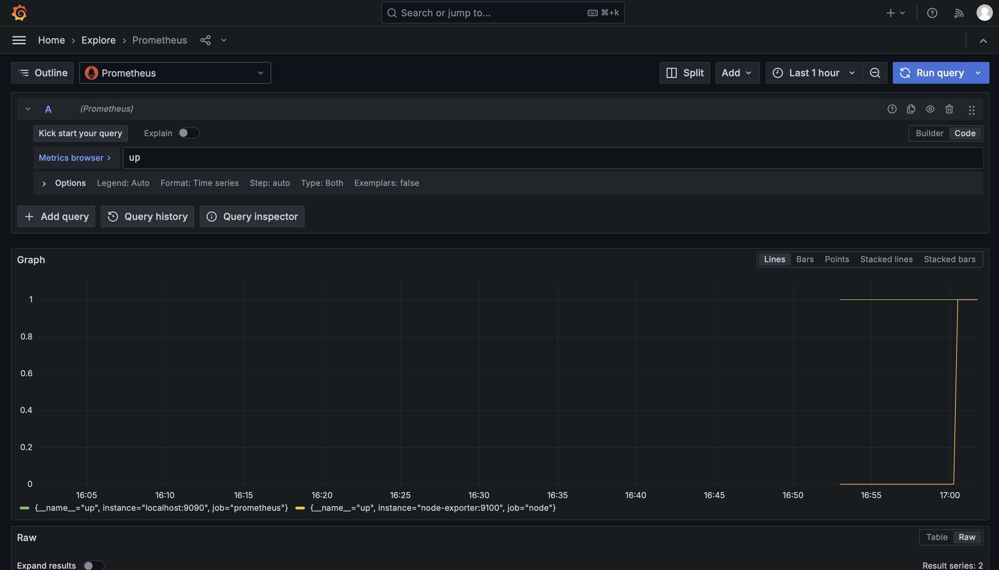

## 7. Скриншоты выполненной работы

### Проверка Prometheus

### Подключение Loki

### Все логи приложения

### Поиск по request_id

### Фильтрация ошибок

### Медленные запросы

### Подсчёт ошибок

### Дополнительный результат
